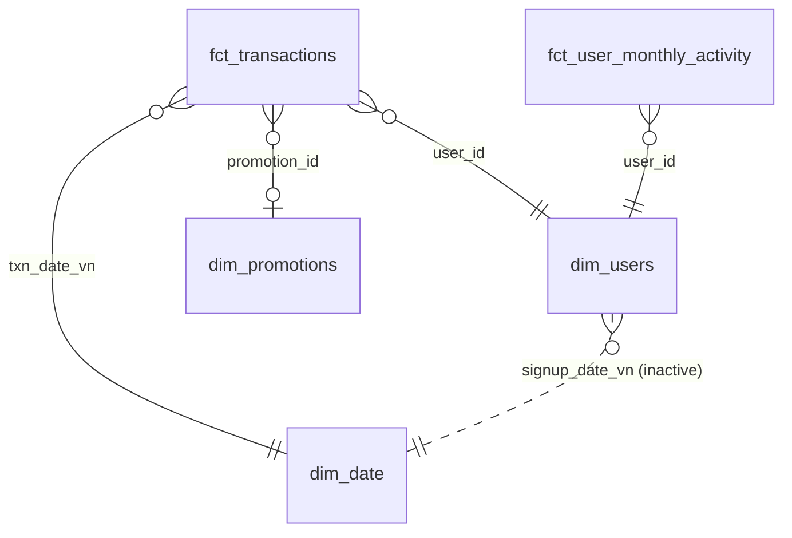

# SaolaPay: e-wallet performance dashboard in Power BI

A Power BI dashboard for a fictional Vietnamese e-wallet. It covers growth, retention, product mix, take
rate, payment health and promotions, across 3 million transactions from 2024 to 2025. The README ends with
four business insights found in the data, each with a recommended action.

> **SaolaPay is fictional and all data is synthetic.** It is not affiliated with any real company.

---

## Business insights

### 1. The new-user cashback campaign bought sign-ups, not customers
The campaign `PROMO_NEWUSER_2025` ran in Mar–Apr 2025 and paid 50 % cashback on a new user's first payment.

| | Users acquired by the campaign | Organic users |
|---|---|---|
| Sign-ups per day during the campaign | ~182 (+52 % vs ~120 baseline) | |
| Activated within 7 days | **83.9 %** | 53.4 % |
| Still active in month 3 | **14.6 %** | 39.5 % |
| Promo cost per user still active in month 3 | **~229k VND** | ~69k VND |

Each customer the campaign retained cost **3.3×** as much as an organic one.
**Recommended action:** pay the cashback on the 2nd or 3rd transaction instead of the first, and shift budget
toward referral. Referral users have the best month-3 retention, at 41.8 %.

### 2. Early bill payment goes with higher retention, but this is not proof that it causes it
Users who pay a bill in their first 30 days are about **2.2× more likely to still be active in month 6**. When
early overall activity is held constant, the gap shrinks to about **1.3–1.5×**. More engaged users simply do
more of everything.
**Recommended action:** run a randomised "pay your first bill" onboarding test before investing in it.

### 3. GMV hid a payment incident
In the week of 11–17 Aug 2025:
- **Android merchant-payment failures jumped to 18.1 %**, against a normal ~3 %.
- iOS stayed flat at 2.9 %.
- Merchant GMV fell only **4.7 %** vs the previous week, because **~62 % of failed payments were retried
  successfully within 10 minutes**.

**Recommended action:** monitor payment success rate by OS, not just GMV. A GMV alert would have missed this
incident.

### 4. Take rate fell because of product mix, not pricing
Take rate dropped from **1.115 % (Mar–May 2025) to 1.072 % (Jul–Dec 2025)**. A mix-vs-rate decomposition
attributes **3.5 of the 4.3 bps** to the mix. Transport payments grew from 8 % to 15 % of GMV, and they carry
a low merchant fee (0.6–0.7 %). Take rate excluding transport was flat.
**Recommended action:** report take rate by merchant category, and decide explicitly whether transport is a
growth product or a margin product.

---

## Dashboard pages

| Page | Business question |
|---|---|
| Executive KPI | How is SaolaPay performing month by month? |
| Growth & Retention | How well do new users activate and stay active, by signup cohort? |
| Product mix & Take rate | How do GMV and take rate differ across products and merchant categories? |
| Payment health | How reliable are payments and refunds over time? |
| Promotion | What do promotions cost, and what revenue do transactions using them generate? |

---

## Data model
A star schema loaded from Parquet files in `data/`.

| Table | Grain | Rows |
|---|---|---|
| `fct_transactions` | one transaction, all statuses, de-duplicated | 3,083,526 |
| `fct_user_monthly_activity` | one user × month with a valid transaction | 247,661 |
| `dim_users` | one user | 79,935 |
| `dim_date` | one day, 2024-01-01 to 2025-12-31 | 731 |
| `dim_promotions` | one promotion | 3 |

**Modelling choices**
- **Single-direction relationships.** All active relationships filter one way only, from dimension to fact.
- **Inactive signup-date relationship.** The link from signup date to the calendar is inactive. Only the
  user-based measures switch it on, with `USERELATIONSHIP`.
- **Business rules live inside the measures.** Exclusions such as successful transactions only, internal test
  accounts removed, and Vietnam time (UTC+7) are built into each measure. They are not left as page filters.
- **Retention only on complete cohorts.** Cohorts too recent to have reached month *k* are excluded rather
  than counted as zero. Without this, recent months would show a fake decline.
- **Auto date/time is off.** `dim_date` is the marked date table.

## Measures (17)

| Folder | Measures |
|---|---|
| Volume | `gmv`, `tpv`, `txn_count`, `avg_ticket` |
| Revenue | `gross_revenue`, `promo_cost`, `net_revenue`, `take_rate`, `arpu` |
| Users | `active_users`, `paying_users`, `new_users` |
| Engagement | `activation_rate_7d`, `retention_m1`, `retention_m3` |
| Health | `payment_success_rate`, `refund_rate` |

Key definitions:
- **GMV:** successful spending payments only (merchant payments, bills, mobile top-ups). Wallet top-ups,
  withdrawals and P2P transfers are excluded.
- **Take rate:** gross revenue / GMV.
- **Payment success rate:** success / (success + failed).
- **Activation:** a spending transaction within 168 hours of sign-up.

---

## Open the report
1. Clone this repository. The simplest is to clone it to `D:\saolapay-analytics-agent`.
2. Open `powerbi/SaolaPay.pbip` in Power BI Desktop. It needs a recent version that supports Power BI Project
   (PBIP) files.
3. If you cloned to a different folder, go to **Transform data → Edit parameters** and set `DataFolder` to
   `<your clone>\data`.
4. Click **Refresh**. It loads ~3M rows and takes about a minute.

The report is a **Power BI Project**: the model, the DAX measures and every page are stored as readable text
files, so changes can be reviewed in git like code.

---

### Tóm tắt (Tiếng Việt)
Dashboard Power BI cho một ví điện tử giả lập. Dữ liệu là 3 triệu giao dịch giai đoạn 2024–2025, mô hình
dạng star schema với 17 DAX measure và 5 trang báo cáo. Bốn insight chính:
- Chương trình khuyến mãi cho người dùng mới tạo được nhiều lượt đăng ký nhưng không giữ chân được khách.
- Người dùng thanh toán hóa đơn sớm có retention cao hơn, nhưng dữ liệu chưa chứng minh đây là nguyên nhân.
- GMV đã che đi một sự cố thanh toán trên Android, vì phần lớn người dùng thanh toán lại thành công.
- Take rate giảm do cơ cấu sản phẩm thay đổi, không phải do giá.
