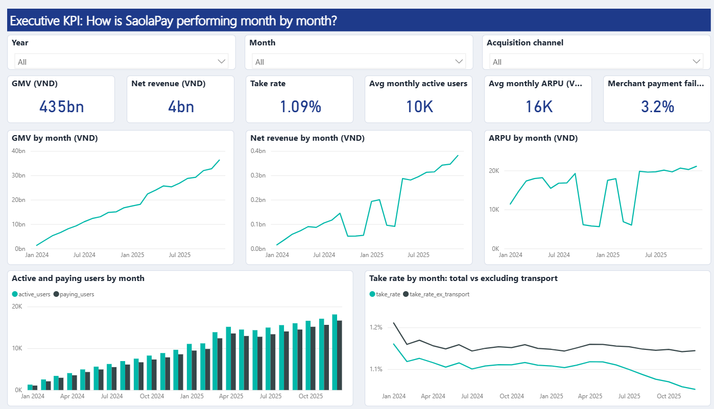
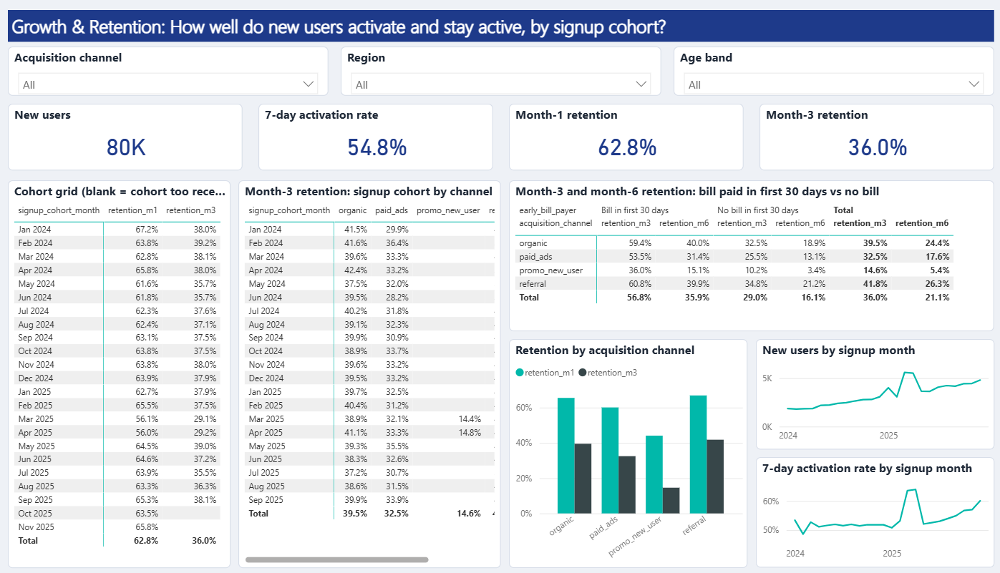
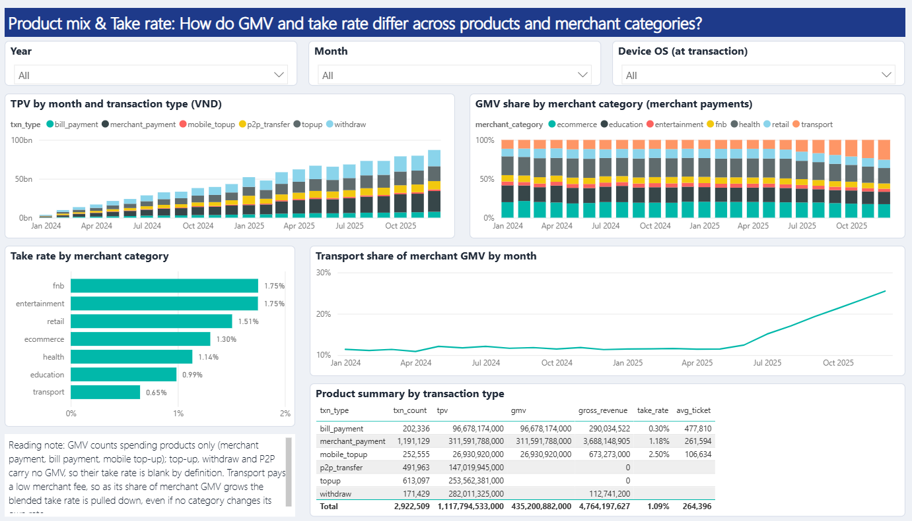
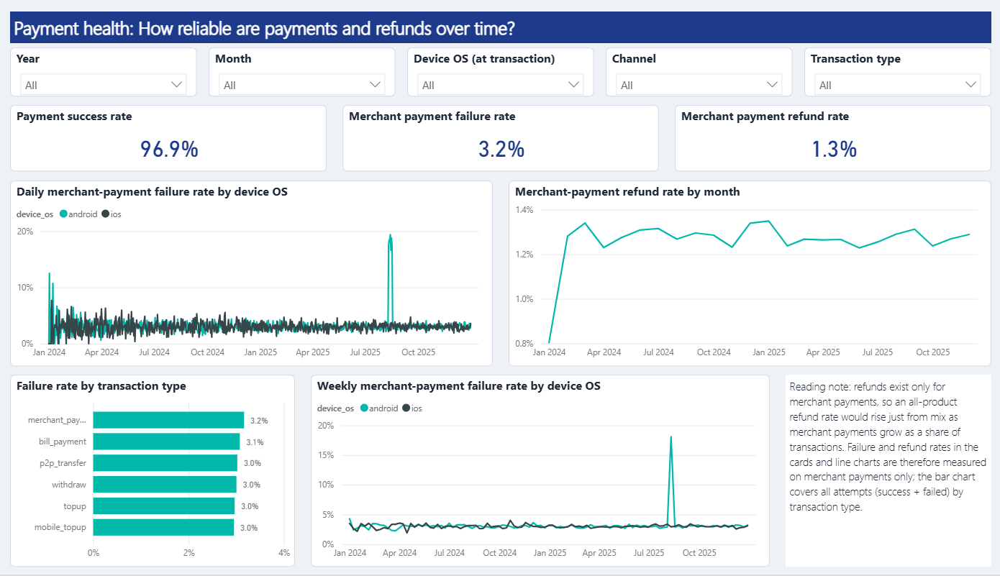
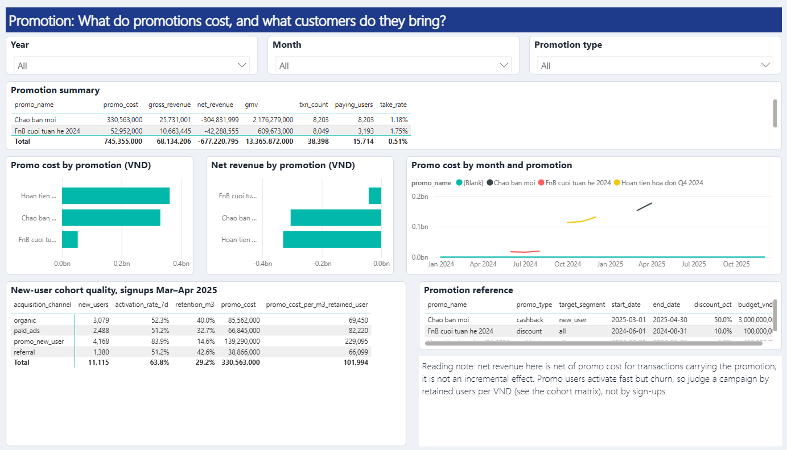
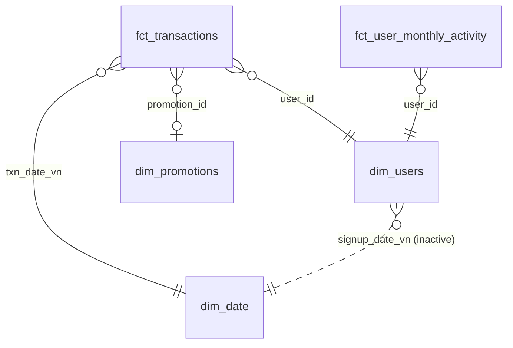

# SaolaPay: e-wallet performance dashboard in Power BI

A Power BI dashboard for a fictional Vietnamese e-wallet. It covers growth, retention, product mix, take
rate, payment health and promotions, across 3 million transactions from 2024 to 2025. Below are four
business insights, each tied to a dashboard visual and paired with a recommended action.

> **SaolaPay is fictional and all data is synthetic.** It is not affiliated with any real company.

---

## Business insights

Each number below comes from a visual in the dashboard. The page is named after every insight, and every
number was re-checked with SQL against the underlying tables.

### 1. The new-user cashback campaign bought sign-ups, not customers
*Promotion page, "New-user cohort quality, signups Mar–Apr 2025"*

`PROMO_NEWUSER_2025` (Mar–Apr 2025) paid 50 % cashback on a new user's first payment. It added about 4,200
sign-ups. This table covers users who signed up in Mar–Apr 2025, by acquisition channel:

| Channel | Users | Active within 7 days | Still active in month 3 | Promo spend per user still active in month 3 |
|---|---|---|---|---|
| Campaign (`promo_new_user`) | 4,168 | **83.9 %** | **14.6 %** | **~229k VND** |
| Organic | 3,079 | 52.3 % | 40.0 % | ~69k VND |
| Referral | 1,380 | 51.2 % | 42.6 % | ~66k VND |
| Paid ads | 2,488 | 51.2 % | 32.7 % | ~82k VND |

Organic users who signed up during the campaign also received the cashback. That is why their row has promo
spend too.

Campaign users activated fast but churned. Per customer still active after three months, the promotion
spent **3.3×** more than it did on organic sign-ups.

**Recommended action:** pay the cashback on the 2nd or 3rd transaction instead of the 1st, and judge
campaigns by retained users per VND, not by sign-ups.

### 2. Paying a bill early goes with much better retention, but that is not proof it causes it
*Growth & Retention page, "Month-3 and month-6 retention: bill paid in first 30 days vs no bill"*

| Channel | Month-6 retention, bill in first 30 days | Month-6 retention, no bill |
|---|---|---|
| Organic | 40.0 % | 18.9 % |
| Referral | 39.9 % | 21.2 % |
| Paid ads | 31.4 % | 13.1 % |

Users who pay a bill early stay active about **twice as often**, in every channel.

Engaged users simply do more of everything. A separate analysis compared users with the same level of
early activity, and there the gap shrinks to about 1.3–1.5×.

**Recommended action:** run a randomised "pay your first bill" onboarding test before putting budget behind
it.

### 3. A payment incident that GMV hid
*Payment health page, "Weekly / Daily merchant-payment failure rate by device OS"*

In the week of 11–17 Aug 2025:
- **The Android merchant-payment failure rate jumped to 18.1 %.** It is normally about 3 %. iOS stayed at
  2.9 %.
- Merchant GMV fell only **4.7 %** against the previous week. Transaction-level analysis shows that about
  62 % of failed Android payments were retried successfully within 10 minutes.
- The incident is diluted when the failure rate covers all products. Across every product, Android failures
  only reach 9.4 %, because top-ups and transfers were unaffected. That is why the dashboard tracks the
  failure rate for merchant payments separately.

**Recommended action:** alert on the merchant-payment failure rate by OS, not on GMV or the all-product
success rate.

### 4. Take rate fell because of product mix, not pricing
*Executive KPI page, "Take rate by month: total vs excluding transport". Product mix page, "Transport share
of merchant GMV by month"*

| | Jun 2025 | Dec 2025 |
|---|---|---|
| Take rate (gross revenue / GMV) | 1.110 % | **1.052 %** |
| Take rate excluding transport | 1.155 % | 1.144 % |
| Transport share of merchant GMV | 12.4 % | **25.5 %** |

Transport doubled its share of merchant GMV and carries a low merchant fee (0.6–0.7 %). Take rate
*excluding* transport barely moved: -1 bp against -6 bps overall.

**Recommended action:** report take rate by merchant category, and decide explicitly whether transport is a
growth product or a margin product. A blanket fee change would not address the cause.

### Caveats: what the data does *not* show
- **Refunds are not rising.** An all-product refund rate climbs from 0.3 % to 0.6 % over two years. That is
  only because merchant payments, the only product that can be refunded, became a larger share. The
  merchant-payment refund rate is flat at about 1.3 % in both years.
- **The rise in activation is not explained.** 7-day activation rises from about 52 % to about 60 % in
  H2-2025 across channels. The data does not explain why (more frequent transport payments are one possible
  driver), so no conclusion is drawn.
- **The dips in net revenue are promotion months, not lost business.** Net revenue and ARPU drop sharply in
  Oct–Dec 2024 and Mar–Apr 2025 while GMV keeps growing. In those months promo cost was 62–71 % of gross revenue:
  the Q4-2024 bill cashback, then the new-user campaign. Each promotion is worth judging against what it bought.
- **Annual totals are not monthly figures.** "Avg monthly active users" (~10.3k) and "Avg monthly ARPU"
  (~15.6k VND) are monthly averages. Counting unique users over the whole two years would overstate both.

---

## Dashboard pages

| Page | Business question |
|---|---|
| Executive KPI | How is SaolaPay performing month by month? |
| Growth & Retention | How well do new users activate and stay active, by signup cohort? |
| Product mix & Take rate | How do GMV and take rate differ across products and merchant categories? |
| Payment health | How reliable are payments and refunds over time? |
| Promotion | What do promotions cost, and what customers do they bring? |

---

## Data model
A star schema loaded from Parquet files in `data/`.

| Table | Grain | Rows |
|---|---|---|
| `fct_transactions` | one transaction, all statuses, de-duplicated | 3,083,526 |
| `fct_user_monthly_activity` | one user × month with a valid transaction | 247,661 |
| `dim_users` | one user | 79,935 |
| `dim_date` | one day, 2024-01-01 to 2025-12-31 | 731 |
| `dim_promotions` | one promotion | 3 |

**Modelling choices**
- **Single-direction relationships.** All active relationships filter one way only, from dimension to fact.
- **Inactive signup-date relationship.** The link from signup date to the calendar is inactive. Only the
  user-based measures switch it on, with `USERELATIONSHIP`.
- **Business rules live inside the measures.** Exclusions such as successful transactions only, internal test
  accounts removed, and Vietnam time (UTC+7) are built into each measure. They are not left as page filters.
- **Retention only on complete cohorts.** Cohorts too recent to have reached month *k* are excluded rather
  than counted as zero. Without this, recent months would show a fake decline.
- **Auto date/time is off.** `dim_date` is the marked date table.

## Measures (28)

| Folder | Measures |
|---|---|
| Volume | `gmv`, `tpv`, `txn_count`, `avg_ticket` |
| Merchant | `merchant_gmv`, `transport_share_merchant_gmv` |
| Revenue | `gross_revenue`, `promo_cost`, `net_revenue`, `take_rate`, `take_rate_ex_transport`, `arpu`, `avg_monthly_arpu` |
| Users | `active_users`, `paying_users`, `new_users`, `avg_mau` |
| Engagement | `activation_rate_7d`, `retention_m1`, `retention_m3`, `retention_m6`, `retained_users_m3` |
| Health | `payment_success_rate`, `failure_rate`, `merchant_failure_rate`, `refund_rate`, `merchant_refund_rate` |
| Promotion | `promo_cost_per_m3_retained_user` |

`dim_users[early_bill_payer]` is a calculated column. It flags users with a valid bill payment within 30 days
of sign-up.

Key definitions:
- **GMV:** successful spending payments only (merchant payments, bills, mobile top-ups). Wallet top-ups,
  withdrawals and P2P transfers are excluded.
- **Take rate:** gross revenue / GMV.
- **Payment success rate:** success / (success + failed).
- **Activation:** a spending transaction within 168 hours of sign-up.

---

## Open the report
1. Clone this repository. The simplest is to clone it to `D:\saolapay-analytics-agent`.
2. Open `powerbi/SaolaPay.pbip` in Power BI Desktop. It needs a recent version that supports Power BI Project
   (PBIP) files.
3. If you cloned to a different folder, go to **Transform data → Edit parameters** and set `DataFolder` to
   `<your clone>\data`.
4. Click **Refresh**. It loads ~3M rows and takes about a minute.

The report is a **Power BI Project**: the model, the DAX measures and every page are stored as readable text
files, so changes can be reviewed in git like code.

---

### Tóm tắt (Tiếng Việt)
Dashboard Power BI cho một ví điện tử giả lập. Dữ liệu là 3 triệu giao dịch giai đoạn 2024–2025, mô hình
dạng star schema với 28 DAX measure và 5 trang báo cáo; mỗi insight gắn với một visual cụ thể. Bốn insight chính:
- Chương trình khuyến mãi cho người dùng mới tạo được nhiều lượt đăng ký nhưng không giữ chân được khách.
- Người dùng thanh toán hóa đơn sớm có retention cao hơn, nhưng dữ liệu chưa chứng minh đây là nguyên nhân.
- GMV đã che đi một sự cố thanh toán trên Android, vì phần lớn người dùng thanh toán lại thành công.
- Take rate giảm do cơ cấu sản phẩm thay đổi, không phải do giá.
